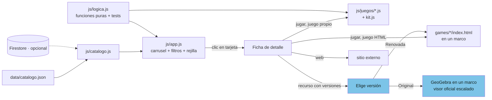

# MathStore

**Página publicada:** <https://esclavotec.github.io/mathstore/> · **Repositorio:** <https://github.com/Esclavotec/mathstore>

Tienda web al estilo de una tienda de videojuegos, pero para **juegos y material didáctico de matemáticas**.
Cada recurso aparece como una tarjeta con **portada y nombre**. Al hacer clic se abre su **ficha** (descripción, tema, nivel, edad, duración, etiquetas y créditos) con un botón que cambia según el tipo:

| Tipo | Botón | Qué hace |
|---|---|---|
| `jugar` | **Jugar** | Abre el juego dentro de la tienda, sin instalar nada |
| `web` | **Ir al sitio web** | Abre el sitio externo en una pestaña nueva |
| `descargar` | **Descargar** | Descarga un archivo. Ahora mismo no se usa, pero el código lo admite |

También tiene un carrusel de destacados, un buscador (no distingue tildes ni mayúsculas), filtros por tema, tipo y nivel, y enlaces directos a cada ficha (`index.html#angulo-ninja`). El logo es una manzana con un gusano.

## Juegos incluidos

| Juego | Tema | Creador | Cómo se juega |
|---|---|---|---|
| **La tiendita de los cuadriláteros** (2 versiones) | Geometría | José Pablo Calderón Gairaud (original) y Antony Arias (renovada) | Compra solo paralelogramos, rectángulos o cuadrados. En la ficha eliges la versión:<br/>• **Original**: *Bolsa de cuadrilateros* de José Pablo Calderón Gairaud (PROMATES), en GeoGebra (<https://www.geogebra.org/m/hj3bdkta>).<br/>• **Renovada**: *La tiendita de los cuadriláteros* de Antony Arias, con lupa, teoría, vitrina final y estrellas |
| **Carrera de Tablas** | Multiplicación | Antony Arias Valle | Carrera contra un auto rival. Eliges qué tablas practicar, hay turbo con 3 aciertos seguidos, 3 carreras cada vez más rápidas y 3 vidas |
| **Pizzería de Fracciones** | Fracciones | Antony Arias Valle | Sirves la fracción de pizza que pide cada cliente tocando las porciones. Los niveles 2 y 3 usan fracciones equivalentes. Hay barra de paciencia y propina |
| **Ángulo Ninja** | Ángulos | Antony Arias Valle | Apuntas y lanzas una estrella a la linterna que está al ángulo pedido, sin transportador. El nivel 3 es de lanzamiento libre. Después de cada tiro se dibuja el ángulo real |

### Descargar los juegos sueltos

Los tres juegos de Antony Arias Valle también existen como **un solo archivo HTML** cada uno. Se abren con doble clic y funcionan sin internet; sin conexión, solo cambian las fuentes por las del sistema.

- `descargas/carrera-tablas.html` · <https://esclavotec.github.io/mathstore/descargas/carrera-tablas.html>
- `descargas/pizzeria-fracciones.html` · <https://esclavotec.github.io/mathstore/descargas/pizzeria-fracciones.html>
- `descargas/angulo-ninja.html` · <https://esclavotec.github.io/mathstore/descargas/angulo-ninja.html>

Los genera `npm run exportar` (`tools/exportar-juegos.mjs`) a partir del mismo código de la tienda. Si cambias un juego, vuelve a exportar; un test avisa si algún HTML quedó desactualizado.

Los tres juegos propios comparten un **kit** (`js/juegos/kit.js`) que aporta:
- pantalla de inicio con instrucciones;
- efectos de sonido generados en el navegador, con botón para silenciarlos;
- textos flotantes ("+10"), confeti y avisos entre niveles;
- pantalla final con 0 a 3 estrellas y récord guardado en el navegador.

Se juegan con ratón, con el dedo en el celular o con el teclado:
- *Carrera:* teclas 1–4 para responder.
- *Pizzería:* Tab y Enter.
- *Ninja:* flechas para apuntar y Enter para lanzar.

Además hay 3 enlaces: GeoGebra, Khan Academy (en español) y PhET.

## Arquitectura



En azul, lo nuevo de la versión 3: el selector de versiones y el original de GeoGebra.

```
index.html                       página principal
favicon.svg                      logo (manzana con gusano)
css/styles.css                   estilos (tema "pizarra" oscuro)
js/firebase-config.js            config de Firebase (null = usar JSON local)
js/catalogo.js                   carga el catálogo: Firestore o data/catalogo.json
js/logica.js                     lógica pura (ejercicios, pedidos, ángulos, filtros), probada con tests
js/juegos/kit.js                 piezas compartidas por los juegos
js/juegos/carrera-tablas.js      \
js/juegos/pizzeria-fracciones.js  > un archivo por juego propio
js/juegos/angulo-ninja.js        /
games/tiendita-cuadrilateros/    juego HTML completo (aportado)
js/app.js                        interfaz de la tienda
data/catalogo.json               la lista de recursos
covers/                          portadas (SVG generadas con tools/generar-portadas.mjs + la imagen de la tiendita)
descargas/*.html                 los 3 juegos como HTML sueltos (generados con npm run exportar)
tests/catalogo.test.mjs          tests automáticos
```

## Cómo usarlo

Hace falta un servidor local porque la página lee `data/catalogo.json` con `fetch`. Si abres `index.html` con doble clic, el catálogo no carga.

```powershell
python -m http.server 8000
```

Después abre <http://localhost:8000>. Para los tests (requiere Node 18 o superior):

```powershell
npm test
```

## Añadir un recurso

Añade un objeto a `data/catalogo.json`:

```json
{
  "id": "mi-recurso",              // minúsculas, números y guiones; se usa en la URL (#mi-recurso)
  "titulo": "Mi recurso",
  "portada": "covers/mi-recurso.svg",  // cualquier imagen 16:9 (svg, png, jpg, webp)
  "descripcion": "Texto que se ve al abrir la ficha.",
  "tema": "Geometría",             // los filtros de tema salen de aquí automáticamente
  "nivel": "primaria",             // primaria | secundaria
  "tipo": "jugar",                 // jugar | web | descargar
  "url": "…",                      // ver abajo
  "etiquetas": ["…"],
  "edad": "8–12 años",             // opcional
  "duracion": "10 min",            // opcional
  "autor": "Nombre",               // opcional: se muestra como «Créditos» en la ficha
  "destacado": false               // true = aparece en el carrusel
}
```

(Los comentarios `//` son solo explicativos: en el JSON real no se ponen.)

Qué va en `url`:
- **Juego HTML que ya tienes** (como la tiendita): cópialo en `games/<id>/index.html` y pon `"url": "games/<id>/index.html"`. Se abre en un marco dentro de la ficha, con un enlace de respaldo para abrirlo en otra pestaña.
- **Juego propio con el kit:** crea `js/juegos/<id>.js` siguiendo el contrato documentado al inicio de `js/juegos/carrera-tablas.js` (`ctx.escenario`, `ctx.marcador`, `ctx.terminar(puntos, resumen, estrellas)`), añade su `<script>` en `index.html` y pon `"url": "<id>"`.
- **Sitio web:** el enlace `https://…`.

**Un juego con varias versiones** (por ejemplo, el original y una renovada) lleva además una lista `versiones`. La ficha muestra entonces «Elige versión», con una tarjeta y un botón por versión:

```json
"versiones": [
  {
    "id": "original",
    "nombre": "Bolsa de cuadrilateros",
    "etiqueta": "Original · GeoGebra",
    "portada": "covers/bolsa-cuadrilateros-geogebra.svg",
    "autor": "José Pablo Calderón Gairaud (PROMATES)",
    "url": "https://www.geogebra.org/material/iframe/id/hj3bdkta",
    "enlace": "https://www.geogebra.org/m/hj3bdkta",
    "boton": "Jugar en GeoGebra"
  },
  { "id": "renovada", "nombre": "La tiendita de los cuadriláteros", "etiqueta": "Versión renovada",
    "portada": "covers/tiendita-cuadrilateros.webp", "autor": "Antony Arias",
    "url": "games/tiendita-cuadrilateros/index.html" }
]
```

Para cualquier actividad de GeoGebra: si su enlace es `geogebra.org/m/XXXX`, usa `url` = `https://www.geogebra.org/material/iframe/id/XXXX`. La tienda le añade sola el ancho y el alto del visor para que la actividad quepa completa. `enlace` es el botón de respaldo para abrirla en geogebra.org.

Después ejecuta `npm test`: avisa si falta un campo, la portada, el archivo del juego o su `<script>`.

## Firebase (opcional)

Sirve para editar el catálogo desde la consola de Firebase sin tocar código.

1. Crea un proyecto en <https://console.firebase.google.com>, activa **Firestore** y registra una app web.
2. Copia el objeto de configuración en `js/firebase-config.js` (guíate por `js/firebase-config.example.js`).
3. Crea la colección `recursos` con un documento por recurso y los mismos campos del JSON. Un campo numérico `orden` es opcional y sirve para ordenarlos.
4. Reglas recomendadas (lectura pública, escritura solo desde la consola):
   ```
   rules_version = '2';
   service cloud.firestore {
     match /databases/{db}/documents {
       match /recursos/{id} { allow read: if true; allow write: if false; }
     }
   }
   ```

Si Firebase falla o la colección está vacía, la tienda usa automáticamente `data/catalogo.json`. El pie de página indica qué fuente se está usando.

## Publicar en GitHub Pages

La tienda ya está publicada: GitHub Pages sirve la rama `main` desde la raíz del repositorio. Para publicar cambios basta con subirlos, y la página se actualiza sola en uno o dos minutos:

```powershell
git add .
git commit -m "Describe tu cambio"
git push
```

## Pruebas realizadas

- **`npm test`: 15 tests en verde.**
  - Catálogo: campos completos, ids únicos, portadas, juegos y `<script>` existentes, que no queden PDF, y la tiendita con sus créditos y su portada WebP.
  - Lógica de los juegos, generando cientos de casos por juego:
    - multiplicaciones con las tablas elegidas;
    - rival más rápido en cada nivel y turbo;
    - pedidos de pizza que siempre se pueden servir con porciones enteras, de 12 porciones como máximo, con más cortes en el nivel 2 y menos en el 3;
    - linternas separadas, impactos y cálculo del ángulo.
  - Búsqueda y filtros.
- **Navegador, en computadora:**
  - Carrera completa, incluida la carrera 2, hasta perder las 3 vidas y ver las estrellas finales.
  - Nivel 1 completo de la Pizzería y entrada al nivel 2.
  - Lanzamientos acertados y fallados en Ángulo Ninja, con el ángulo revelado.
  - La tiendita carga dentro de la tienda y su primera actividad funciona.
- **Navegador, en celular (375 px):** los 4 juegos y la tienda, sin desbordes horizontales.

## Cambios

### Versión 4
- **Creador:** Antony Arias Valle figura en Carrera de Tablas, Pizzería de Fracciones y Ángulo Ninja:
  - en la ficha de la tienda («Créditos»);
  - en la pantalla de inicio de cada juego («Creado por»);
  - en la cabecera del código;
  - en cada HTML suelto (pie y `<meta name="author">`).
- **Juegos sueltos:** `descargas/*.html`, un archivo por juego que funciona sin la tienda, generado con `npm run exportar`.
- **2 tests nuevos (15 en total):**
  - el creador aparece en los tres juegos;
  - los HTML sueltos existen, no dependen de otros archivos y están al día.
- **Probado en el navegador:** los tres HTML sueltos cargan sin pedir ningún otro archivo. Jugué una ronda de cada uno y en Carrera usé también «Jugar otra vez».

### Versión 3
- **La tiendita ahora tiene 2 versiones en una sola ficha:**
  - el **original** de GeoGebra, *Bolsa de cuadrilateros* de José Pablo Calderón Gairaud (PROMATES), con portada propia;
  - la **versión renovada** de Antony Arias.
- La tarjeta muestra la insignia «2 versiones» y el carrusel dice «Elegir versión».
- El original se juega dentro de la tienda con el visor oficial de GeoGebra, escalado al tamaño del visor y con botón de pantalla completa. También hay un enlace para abrirlo en geogebra.org.
- Nuevo test (13 en total) que comprueba las dos versiones, sus portadas, sus enlaces y sus créditos.
- Probado en el navegador:
  - las dos versiones se abren desde la ficha y «Volver» regresa al selector;
  - GeoGebra carga escalado;
  - en celular, las tarjetas de versión se apilan sin desbordar.

### Versión 2
- **Logo nuevo:** manzana con un gusano, también como icono de la pestaña.
- **Se quitaron las fichas PDF:** carpeta `material/`, portadas, generador y filtro «Descargable». El tipo `descargar` sigue disponible en el código.
- **Juegos rehechos:**
  - *Carrera de Tablas:* carrera contra un rival, turbo, vidas, 3 niveles y selector de tablas.
  - *Fracción Exacta* se reemplazó por la *Pizzería de Fracciones*.
  - *Ángulo Ninja:* apuntar y lanzar a las linternas, más un nivel de lanzamiento libre.
  - Los tres tienen pantalla de inicio, sonidos, estrellas y funcionan con el dedo.
- **Nuevo juego:** *La tiendita de los cuadriláteros*, con soporte para juegos HTML completos dentro de la tienda.
- **Fallos corregidos durante las pruebas:**
  - La línea de meta de la carrera usaba la misma clase CSS que la fila de datos de las tarjetas y las desacomodaba. Ahora se llama `.linea-meta`.
  - En celular, el globo del pedido de la pizzería desbordaba la pantalla.
  - El nivel 2 podía generar pizzas de 16 porciones.

### Versión 1
- Tienda, 3 juegos, 2 fichas PDF, 3 enlaces, Firebase opcional y tests.
- Se publicó en GitHub Pages y se añadió `.gitattributes` para proteger los archivos binarios.
