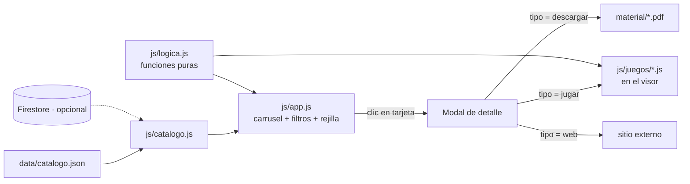

# MathStore

**Página publicada:** <https://esclavotec.github.io/mathstore/> · **Repositorio:** <https://github.com/Esclavotec/mathstore>

Tienda web al estilo de una tienda de videojuegos, pero para **juegos y material didáctico de matemáticas**.
Cada recurso aparece como una tarjeta con **portada y nombre**. Al hacer clic se abre su **ficha** (descripción, tema, nivel, edad, duración y etiquetas) con un botón que cambia según el tipo:

| Tipo | Botón | Qué hace |
|---|---|---|
| `jugar` | **Jugar** | Abre el juego dentro de la página (sin instalar nada) |
| `descargar` | **Descargar** | Descarga el archivo (las fichas PDF de `material/`) |
| `web` | **Ir al sitio web** | Abre el sitio externo en una pestaña nueva |

También tiene un carrusel de destacados, un buscador (no distingue tildes ni mayúsculas), filtros por tema, tipo y nivel, y enlaces directos a cada ficha (`index.html#angulo-ninja`).

## Contenido incluido

- **3 juegos propios**:
  - *Carrera de Tablas*: multiplicaciones contra el reloj, con rachas.
  - *Fracción Exacta*: elegir la fracción mayor, con barras visuales.
  - *Ángulo Ninja*: estimar ángulos en grados.

  Todos tienen puntaje, temporizador y récord guardado en el navegador.
- **2 fichas PDF**: sumas y restas con llevadas (3 páginas) y ecuaciones de primer grado. Las dos incluyen soluciones.
- **3 enlaces**: GeoGebra, Khan Academy (en español) y PhET.

## Arquitectura



```
index.html               página principal
css/styles.css           estilos (tema "pizarra" oscuro)
js/firebase-config.js    config de Firebase (null = usar JSON local)
js/catalogo.js           carga el catálogo: Firestore o data/catalogo.json
js/logica.js             lógica pura (generar ejercicios, puntuar, filtrar), probada con tests
js/juegos/*.js           un archivo por juego
js/app.js                interfaz de la tienda
data/catalogo.json       la lista de recursos
covers/*.svg             portadas (generadas con tools/generar-portadas.mjs)
material/*.pdf           fichas (generadas con tools/generar-pdfs.mjs)
tests/catalogo.test.mjs  tests automáticos
```

## Cómo usarlo

Hace falta un servidor local porque la página lee `data/catalogo.json` con `fetch` (si abres `index.html` con doble clic, el catálogo no carga).

```powershell
python -m http.server 8000
```

Después abre <http://localhost:8000>. Para los tests (requiere Node 18 o superior):

```powershell
npm test
```

## Añadir un recurso

Añade un objeto a `data/catalogo.json`:

```json
{
  "id": "mi-recurso",              // minúsculas, números y guiones; se usa en la URL (#mi-recurso)
  "titulo": "Mi recurso",
  "portada": "covers/mi-recurso.svg",  // cualquier imagen 16:9 (svg, png, jpg)
  "descripcion": "Texto que se ve al abrir la ficha.",
  "tema": "Geometría",             // los filtros de tema salen de aquí automáticamente
  "nivel": "primaria",             // primaria | secundaria
  "tipo": "web",                   // jugar | descargar | web
  "url": "https://…",              // jugar → id del juego · descargar → ruta del archivo · web → enlace
  "etiquetas": ["…"],
  "edad": "8–12 años",             // opcional
  "duracion": "10 min",            // opcional
  "destacado": false               // true = aparece en el carrusel
}
```

(Los comentarios `//` son solo explicativos: en el JSON real no se ponen.) Luego ejecuta `npm test`: avisa si falta un campo, la portada o el archivo.

**Para crear un juego nuevo**: crea `js/juegos/<id>.js` siguiendo el contrato documentado al inicio de `js/juegos/carrera-tablas.js` (`ctx.escenario`, `ctx.marcador`, `ctx.terminar`), añade su `<script>` en `index.html` y un recurso con `"tipo": "jugar"` y `"url": "<id>"`.

## Firebase (opcional)

Sirve para editar el catálogo desde la consola de Firebase sin tocar código.

1. Crea un proyecto en <https://console.firebase.google.com>, activa **Firestore** y registra una app web.
2. Copia el objeto de configuración en `js/firebase-config.js` (guíate por `js/firebase-config.example.js`).
3. Crea la colección `recursos` con un documento por recurso y los mismos campos del JSON. Un campo numérico `orden` es opcional y sirve para ordenarlos.
4. Reglas recomendadas (lectura pública, escritura solo desde la consola):
   ```
   rules_version = '2';
   service cloud.firestore {
     match /databases/{db}/documents {
       match /recursos/{id} { allow read: if true; allow write: if false; }
     }
   }
   ```

Si Firebase falla o la colección está vacía, la tienda usa automáticamente `data/catalogo.json`. El pie de página indica qué fuente se está usando.

## Publicar en GitHub Pages

La tienda ya está publicada: GitHub Pages sirve la rama `main` desde la raíz del repositorio. Para publicar cambios basta con subirlos; la página se actualiza sola en uno o dos minutos:

```powershell
git add .
git commit -m "Describe tu cambio"
git push
```

`.gitattributes` marca los PDF como binarios para que git no los dañe al convertir los saltos de línea en Windows.

## Pruebas realizadas

- `npm test`: 9 tests en verde. Comprueban los campos del catálogo, que no haya ids repetidos, que existan las portadas, los juegos y los PDF (que deben ser PDF reales), que estén los tres tipos de botón, la lógica de los tres juegos (500 ejercicios generados por juego) y los filtros y el buscador.
- Navegador:
  - Cada tipo de botón muestra el texto y el enlace correctos.
  - El buscador filtra («angulo» → 1 de 8).
  - Se jugaron partidas completas de *Fracción Exacta* (con pantalla final y récord guardado), una ronda de *Ángulo Ninja* y una pregunta de *Carrera de Tablas*.
  - En móvil (375 px) no hay desplazamiento horizontal.

## Cambios en esta versión

- Publicada en GitHub (repositorio público `mathstore`) con GitHub Pages activado. Se añadió `.gitattributes` para proteger los PDF.

- Primera versión: tienda, 3 juegos, 2 fichas PDF, 3 enlaces, Firebase opcional y tests.
- Corrección durante las pruebas: al cerrar y reabrir el modal muy rápido, el evento `close` (que llega con retraso) borraba el juego recién abierto. Ahora se ignora si el modal ya está abierto otra vez.
- Cambio respecto al plan: los juegos son archivos JS (`js/juegos/`) que se montan dentro del modal en vez de páginas HTML sueltas en `games/`. Así funcionan igual en GitHub Pages y en la vista publicada, donde no se pueden usar iframes.
